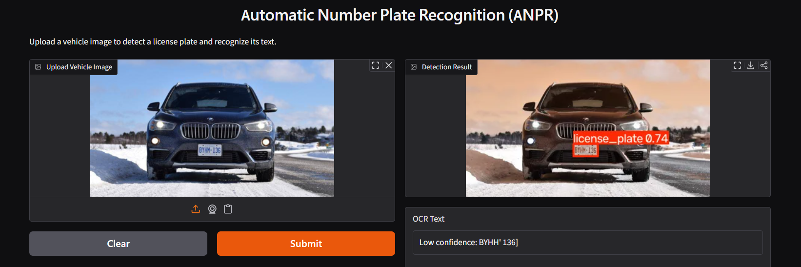
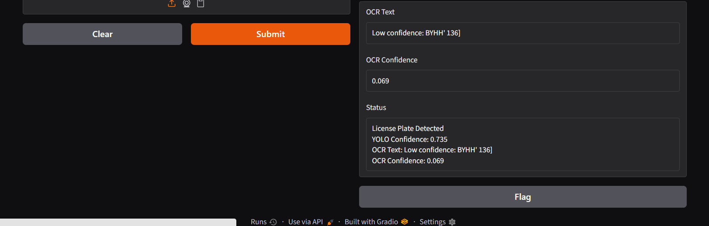

AI Internship
Week 1 - Data Analysis
This repository contains my Week 1 internship work.
The project demonstrates basic Python, NumPy, and Pandas operations.
The notebook loads a CSV dataset, explores the data, selects rows and columns, filters data, and calculates basic summary statistics.
# Week 2 — Exploratory Data Analysis
This project contains my Week 2 internship work on exploratory data analysis.
## Dataset
The dataset contains football player statistics from Kaggle, with 3,120 players and 65 columns.
## What I Learned
- Exploring datasets using Pandas
- Cleaning and converting data
- Filtering and grouping data
- Calculating summary statistics
- Creating visualizations using Matplotlib
- Finding patterns and insights in a real-world dataset

## Week 3 — First Machine Learning Model
This week I built my first machine learning classification model using the Iris dataset and scikit-learn.
### What I learned
- Split data into training and testing sets
- Created and trained a K-Nearest Neighbours (KNN) classifier
- Made predictions on unseen test data
- Measured model accuracy
- Created and interpreted a confusion matrix
- Used a classification report to evaluate the model
- Learned why testing on unseen data is important
### Result
The KNN model achieved 100% accuracy on the test set. The confusion matrix showed that all 30 test samples were classified correctly with no misclassifications.

# Week 4: Better Models and Honest Evaluation
## Overview
This week focused on improving and evaluating machine learning models using the Iris dataset. I worked with KNN, Decision Tree, and Random Forest classifiers and compared their performance using training accuracy, test accuracy, and cross-validation.

## What I Learned

* How Decision Tree and Random Forest classifiers work
* How to compare different machine learning models
* How to identify possible overfitting
* Why test accuracy can sometimes be misleading
* How changing the `random_state` can affect model performance
* How to use 5-fold cross-validation for a more reliable evaluation
* How feature scaling affects KNN performance
* How to interpret confusion matrices and classification reports
* How to tell when the difference between models is too small to mean anything

## Models Compared

| Model         | Training Accuracy | Test Accuracy | 5-Fold CV Mean |
| ------------- | ----------------: | ------------: | -------------: |
| KNN           |            95.83% |          100% |         95.83% |
| Decision Tree |              100% |        93.33% |         94.17% |
| Random Forest |              100% |           90% |         95.00% |

The Decision Tree and Random Forest scored 100% on the training data but lower on the test data, which is a sign of some overfitting.

## Cross-Validation

All three models were evaluated using 5-fold cross-validation on the training data. The averages were **95.83%** for KNN, **95.00%** for Random Forest, and **94.17%** for the Decision Tree.

This provides a more reliable estimate of model performance than relying on a single train-test split.

## Random State Investigation

The KNN model was tested using random states **42, 0, 1, and 7**. The test accuracy was 100% for random states 42, 0, and 7, while it decreased to 96.67% for random state 1. This showed that model accuracy can change depending on how the data is split.

## Feature Scaling

Scaling the features (fitted on the training data only, to avoid data leakage) did not improve KNN. Its test accuracy went down from 100% to 93.33%.

## Conclusion

KNN achieved the highest test accuracy on this particular split, but that 100% was partly luck, as the random state investigation showed. The cross-validation scores of the three models are very close (95.83%, 95.00% and 94.17%). That is a difference of only a couple of flowers out of 120, so on the Iris dataset the three models are **too close to call**. The experiment showed why a single accuracy score, especially a perfect 100% score, should be investigated rather than automatically treated as evidence of a perfect model.

# Week 5 – Deep Learning with PyTorch

## Overview
This week focused on learning the basics of deep learning using **PyTorch** and building a neural network to classify handwritten digits from the **MNIST dataset**.

## What I Did
* Set up PyTorch and enabled the **Google Colab GPU (Tesla T4)**
* Learned about **PyTorch tensors and Autograd**
* Loaded and prepared the **MNIST dataset** (60,000 training images and 10,000 test images)
* Built a neural network from scratch using PyTorch (784 → 128 → 10)
* Implemented the complete **training loop**
* Plotted the training loss curve
* Evaluated the model's test accuracy
* Examined misclassified images
* Added **Dropout (0.2)** as an improvement and compared it with the baseline using **three random seeds**

## Technologies

* Python
* PyTorch
* Torchvision
* Matplotlib
* Google Colab
* MNIST Dataset

## Results

| Model | Seed 42 | Seed 0 | Seed 7 | Average Test Accuracy |
|---|---|---|---|---|
| Baseline | 97.43% | 97.28% | 97.24% | **97.32%** |
| With Dropout (0.2) | 97.49% | 97.39% | 97.34% | **97.41%** |

* The training loss decreased steadily over 5 epochs, which shows that the model was learning.
* In a single run, the baseline model classified about **97.4%** of the 10,000 test images correctly. It misclassified about **260** images, often visually similar digits.
* Dropout scored **0.09 percentage points** higher on average. That is roughly 9 images out of 10,000, which is a very small difference.

## Conclusion
This week helped me understand how PyTorch neural networks are trained using **forward pass, loss calculation, backpropagation, and optimizer updates**. I also learned that a single run is not enough to say a change is an improvement. Dropout was slightly better in all three seeds, but the gain was tiny, so both models performed well on MNIST.
# Week 6 – Object Detection and OCR (ANPR)

## Overview

This project implements a basic **Automatic Number Plate Recognition (ANPR)** system using **YOLO** for license plate detection and **EasyOCR** for text recognition.

**Pipeline:**
Image → YOLO → License Plate Crop → EasyOCR → Plate Text

## Dataset

* Training Images: **346**
* Testing Images: **87**
* Classes: **1 (`license_plate`)**

## What I Did

* Prepared and verified the license plate dataset.
* Fine-tuned a pretrained YOLO model using transfer learning.
* Detected license plates in an unseen image.
* Cropped the detected license plate and enlarged it 4× for OCR.
* Used EasyOCR to recognize the plate text.
* Applied a format check to correct likely OCR character errors.
* Evaluated the limitations of OCR.

## Results

* YOLO detection (87-image validation set): precision **0.933**, recall **0.851**, mAP@50 **0.923**, mAP@50-95 **0.541**
* Detection confidence on the test image: **0.933**
* License plate cropping: **Successful**
* EasyOCR on the enlarged crop returned `IND` (the country code, confidence 0.989) and `MHO 1AE8Q1Z|` (the plate, confidence 0.095)
* After the format check, `MHO 1AE8Q1Z|` became **`MH01AE8017`**, which matches the Indian plate format

## Findings

YOLO successfully detected the license plate, while OCR performance was affected by image quality and plate characteristics. The OCR result with the lowest confidence turned out to be the plate itself, so confidence tells how sure the OCR is, not whether it is right. Checking the text against the expected plate format (two letters, two digits, letters, four digits) fixed the letter/digit mix-ups. Even so, a plate that matches the format still has to be checked against the image.

## Conclusion

The complete **YOLO + EasyOCR ANPR pipeline** was successfully implemented and tested. The project provided practical experience with **object detection, transfer learning, image processing, OCR, and format checking**.

# Week 7: Capstone Build – ANPR Pipeline
## Overview
This project is an end-to-end **Automatic Number Plate Recognition (ANPR)** pipeline using YOLO and EasyOCR. It takes an input image, detects the license plate, reads its text, and returns the final result.
## Pipeline
**Input Image → YOLO Detection → Plate Crop → Preprocessing (4× enlargement) → EasyOCR → Final Result**

## Tools

* Python
* PyTorch
* Ultralytics YOLO
* EasyOCR
* OpenCV
* NumPy
* Google Colab

## Dataset & Evaluation

The dataset has one class: `license_plate`. In the first training run, the 87 test images were also used as the validation set, so the test images helped choose the model and the metrics were slightly optimistic (mAP@50 0.930). I fixed this by splitting a separate validation set from the training images and retraining for **20 epochs**:

* Training: **277 images**
* Validation: **69 images**
* Test: **87 images** (kept untouched for final evaluation)

| Metric (69-image validation set) | Result |
| --------- | -----: |
| Precision |  0.925 |
| Recall    |  0.826 |
| mAP@50    |  0.904 |
| mAP@50-95 |  0.554 |

## Example Input & Output

The complete pipeline was tested on a fresh image:

**Input:** `Cars164.png`

YOLO detected the license plate with **0.857 confidence**.

EasyOCR returned:

```text
Detected Text: GT
OCR Confidence: 0.998
```

This is correct for this plate. Weak text pieces below the 0.50 confidence threshold were dropped. The result was also saved to `anpr_result.txt`. One image is an example, not an evaluation, so I also tested 20 images.

## 20-Image Evaluation

I selected 20 test images, wrote down the plate text by hand, and ran the pipeline on all of them.

* **Plate found:** 18 of 20 images (**90%**)
* **Read exactly right:** 2 of 14 scorable images (**14.3%**). Six images were excluded because the plate text was unclear (blurry, blocked, or not visible).

## Findings

* YOLO detects plates well, but reading the text is the weak part of the pipeline.
* mAP@50 only measures finding the plate, not whether the final text is correct.
* The exact-match rate is the number an ANPR system is judged on, and it was low here.
* Picking text by confidence is not reliable. In Weeks 6 and 7, the low-confidence result was often the plate itself.

## Conclusion

This project combines **object detection and OCR into one working ANPR pipeline**. It can take a new vehicle image, detect the license plate, and return text. The 20-image test shows detection works well, while OCR needs improvement, which Week 8 works on.

## How to Run

Open `Week_7_Capstone_ANPR_Pipeline.ipynb` in Google Colab, provide a vehicle image, and run the cells in order to obtain the final plate detection and OCR result.

# Week 8 – Capstone App: License Plate Detection and OCR

## Overview

This project packages my license plate detection and OCR model into a simple Gradio web app. A user can upload a car image and the app detects the license plate and attempts to read the plate text.

## How It Works

**Image → YOLO → License Plate Detection → Crop → EasyOCR → Result**

The application uses a YOLO model trained for license plate detection and EasyOCR for reading the detected plate region.
## Model Results

- **Dataset:** 346 training images and 87 test images
- **Classes:** 1 (`license_plate`)
- **YOLO mAP@50:** 0.930 (Week 7 result; reported separately from the Week 8 evaluation)
- **Plate detection rate:** 95.0% (19 of 20 test images)
- **OCR exact-match rate:** 61.5% (8 of 13 scorable images)
- **OCR tool:** EasyOCR

### Evaluation Method

The Week 8 pipeline was evaluated on 20 selected test images. License plate text was manually checked against the OCR predictions. Seven images were excluded from exact-match scoring because their ground-truth text was unclear or marked `UC`. Exact matches were calculated after normalizing letter case, spaces, and punctuation.

### Findings

The model detected license plates in 19 of 20 test images (95.0%). OCR matched the manually verified text exactly in 8 of 13 scorable images (61.5%). These results suggest that plate detection performed well on this sample, while OCR text recognition still needs improvement. The evaluation covers only 20 images and should not be treated as a result for the entire 87-image test set.
## Example Screenshots

### Gradio App



### Detection and OCR Result



## Files

* `app.py` – Gradio application
* `best.pt` – trained YOLO model
* `requirements.txt` – required Python packages
* `Week_8_App_Deployment.ipynb` – Week 8 notebook
* `Cars42.png` – example car image

## Running the App

Install the required packages:

```bash
pip install -r requirements.txt
```

Then run:

```bash
python app.py
```

The app opens a Gradio interface where a user can upload an image and view the detection and OCR result.

## Example Input

The repository includes `Cars42.png` as an example input image.

## Project Goal

The goal of Week 8 was to package the AI model into a usable application so that someone can interact with the model without needing to read or modify the source code.

